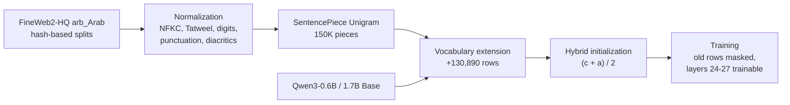

<div align="center">

# AraToken

**Optimizing Arabic Tokenization with Normalization Pipeline and Language Extension for Qwen3**

Mark Kashirskiy<sup>1,2</sup>, Artiom Lipinski<sup>3</sup>, Ilya Makarov<sup>4</sup>

<sup>1</sup>HSE University &nbsp; <sup>2</sup>ITMO University &nbsp; <sup>3</sup>Saint Petersburg State University &nbsp; <sup>4</sup>Trusted AI Center, RAS

[](https://arxiv.org/abs/2512.18399)
[](https://huggingface.co/mariklolik/AraToken-Qwen3-0.6B-LEP)
[](https://huggingface.co/datasets/mariklolik/AraToken-FineWeb2-HQ-ar)
[](LICENSE)

</div>

The Qwen3 tokenizer spends 2.2 tokens on an average Arabic word. AraToken spends 1.2. It is a
SentencePiece Unigram tokenizer trained on FineWeb2-HQ Arabic after an explicit orthographic
normalization step. The Language Extension Pipeline (LEP) puts its vocabulary into a pretrained Qwen3
model. The added embedding rows start from the average of two estimates, one built from the token's
Qwen3 sub-tokens and one from similar whole Qwen3 tokens. The original rows stay frozen, and training
touches only the new rows and the top four transformer layers.

This revision evaluates Arabic adaptation in a 78-run campaign with three training seeds, 49 checkpoint–task blocks and a six-checkpoint serving panel. The revision source accompanies this
guide; its private run artifacts are supplied separately as `outputs/rebuttal/`. They are not claimed
to be published on GitHub or Hugging Face. See [Reproducing the revision](#reproducing-the-revision)
for the command and artifact map.

<div align="center">

<br><sub>The same words under each tokenizer, each after its own normalization. Pieces are joined with "+".</sub>
</div>

## Results

Arabic tokenization improves from 2.179 to 1.212 tokens per word on the held-out test split
(1.281 with the 60K pruned tokenizer). All six controlled Arabic BPC contrasts favor LEP over CPT:

| Model | Steps | Trainable policy | LEP Arabic BPC | CPT Arabic BPC |
|---|---:|---|---:|---:|
| 0.6B | 2,000 | Top four | 1.4111 | 1.5138 |
| 0.6B | 2,000 | Full | 1.2794 | 1.3780 |
| 0.6B | 5,087 | Top four | 1.3551 | 1.4782 |
| 0.6B | 5,087 | Full | 1.2197 | 1.3226 |
| 1.7B | 2,000 | Top four | 1.3224 | 1.3577 |
| 1.7B | 2,000 | Full | 1.2088 | 1.2699 |

Values are means across seeds 1, 2 and 3 on the same 1,500 canonical Arabic documents, with prefixes
of at most 512 Unicode characters; lower is better. All six contrasts survive the declared Holm
correction. The nominal token budgets match, but text exposure, parameter counts and compute differ.
The test set had already been inspected. The fixed half-weight initializer improves on both components
at the original 0.6B budget and at 1.7B; its difference from the analogical component at the longer
0.6B budget remains unresolved.

On the five-task Arabic panel, LEP has the highest macro point estimate: **40.65%**, versus **39.58%**
for CPT and **39.20%** for the base. The LEP–CPT macro difference is 1.07 percentage points
(95% interval −0.81 to 2.94; Holm-adjusted p = 0.535); neither LEP macro comparison establishes an
aggregate gain. LEP exceeds CPT on MadinahQA, ArabicEXAMS and AlGhafa, and is lower on ArabicMMLU
and AraTrust. These are custom-protocol subset results, not official leaderboard scores.
English macro accuracy is **62.92%** for LEP, **58.33%** for CPT and **66.65%** for the base:
retention improves over CPT but remains below the unadapted base.

LEP takes 23–28% more trainer time and more peak allocated memory than its paired CPT controls.
The 78 successful runs sum to **272.5731 single-GPU trainer hours**. This includes in-loop validation
and checkpointing, excludes preparation, initialization, final saving and separate evaluations, and
is not an exact whole-campaign cost. The serving panel reports measured latency, token/character
throughput and memory separately; tokenizer compression alone does not establish serving speed.

## Models and data

The Hub model links below are **historical public checkpoints**, not the new campaign models.
New final-step checkpoints remain private under `outputs/rebuttal/runs/<run>/model/final_model`; their identities are recorded in the supplied provenance. The example below loads a historical model.

| | |
|---|---|
| [mariklolik/AraToken-Qwen3-0.6B-LEP](https://huggingface.co/mariklolik/AraToken-Qwen3-0.6B-LEP) | Qwen3-0.6B-Base with AraToken, 500M tokens of adaptation |
| [mariklolik/AraToken-Qwen3-1.7B-LEP](https://huggingface.co/mariklolik/AraToken-Qwen3-1.7B-LEP) | Qwen3-1.7B-Base with AraToken and the hybrid initializer, 2,000 steps |
| [mariklolik/AraToken-Qwen3-0.6B-CPT](https://huggingface.co/mariklolik/AraToken-Qwen3-0.6B-CPT), [-1.7B-CPT](https://huggingface.co/mariklolik/AraToken-Qwen3-1.7B-CPT) | the matching baselines with the original tokenizer |
| [mariklolik/AraToken](https://huggingface.co/mariklolik/AraToken) | every tokenizer of the paper, including the extended Qwen3 tokenizers and the 80K algorithm grid |
| [mariklolik/AraToken-FineWeb2-HQ-ar](https://huggingface.co/datasets/mariklolik/AraToken-FineWeb2-HQ-ar) | the four document splits (4.1 GB) |
| [`tokenizers/`](tokenizers) | the AraToken SentencePiece models, also kept in this repository |

```python
from transformers import AutoModelForCausalLM, AutoTokenizer

repo = "mariklolik/AraToken-Qwen3-0.6B-LEP"
tokenizer = AutoTokenizer.from_pretrained(repo)
model = AutoModelForCausalLM.from_pretrained(repo, torch_dtype="bfloat16")

ids = tokenizer("تقع مدينة الإسكندرية على", return_tensors="pt").input_ids
print(tokenizer.decode(model.generate(ids, max_new_tokens=40)[0]))
```

The extended tokenizer normalizes its input itself. The bare SentencePiece models expect text that has
already gone through the same normalizer:

```python
import sentencepiece as spm
from aratoken.normalizer import paper_normalizer

sp = spm.SentencePieceProcessor(model_file="tokenizers/fw2hq_sp_alif_preserve/sentencepiece.model")
print(sp.encode(paper_normalizer().normalize_str("وسيكتبونها في مكتباتهم"), out_type=str))
```

## How it works



| Step | Code | What happens |
|---|---|---|
| Normalization | `aratoken/normalizer.py` | A `tokenizers` normalizer applies NFKC, drops Tatweel, maps Arabic-Indic digits and Arabic punctuation to Latin forms and strips diacritics. Alif unification exists but is off by default, because the hamza position carries grammatical information. |
| Tokenizer | `scripts/tokenizer/train.py`, `prune.py` | Unigram with 150,000 pieces on the `tok-train` split. Pruning keeps the most frequent pieces up to 99% or 95% corpus coverage (109,844 or 60,149 pieces). |
| Extension | `aratoken/vocab.py` | Adds every AraToken piece that starts with an Arabic letter and is missing from the Qwen3 vocabulary. |
| Initialization | `aratoken/init.py` | The compositional estimate c is the mean of the Qwen3 sub-token embeddings. The analogical estimate a is the overlap-weighted mean of the Qwen3 tokens that share the most character 2-4-grams. The new row is (c + a) / 2. The revision compares random, compositional mean, moment-matched mean, this analogical component and mixtures. Historical `wechsel`/`focus` options are lexical proxies, not implementations of the published methods. |
| Training | `aratoken/training.py` | A backward hook zeroes the gradient of the original embedding rows. Qwen3 ties input and output embeddings, so this also freezes their output rows. |

## Repository layout

```
aratoken/            normalizer, pre-tokenizer, split rule, vocabulary extension, initializers,
                     gradient masking, metrics, statistics
configs/             Hydra config of an adaptation run, tokenizer registries for the comparisons
scripts/data/        split builder, MinHash leakage check, pretokenization
scripts/tokenizer/   Unigram / BPE / WordPiece training, pruning, Qwen3 vocabulary extension
scripts/lep/         embedding initialization, run manifest, training entry point
scripts/eval/        fertility, BPC, significance tests, OALL, classification
scripts/paper/       LaTeX tables, figures, number check against the manuscript
slurm/               launchers for the run grid, the 500M-token runs and the tokenizer grid
tokenizers/          AraToken SentencePiece models
data/splits/         split manifest and the test and dev document ids
results/             measurements behind the tables and figures (JSON)
paper/               manuscript source, generated tables and figures
tests/               normalizer, split rule, gradient masking, tokenizer round trip
```

## Setup

Use the supplied revision source checkout as the working directory. Installing the public repository alone does not supply the private campaign artifacts or checkpoints.

```bash
python -m venv .venv
source .venv/bin/activate
pip install -e ".[eval,paper,test]"
```

The campaign used Linux, Python 3.11, PyTorch 2.5.1, Transformers 4.51.3 and datasets 4.0.0;
package pins are in `pyproject.toml` and the full recorded environment is in
`outputs/rebuttal/provenance/pip-freeze.txt`. Packed Arrow artifacts require the recorded datasets
version. Training used one H100 80GB per process. No fresh full-install or hardware-minimum claim
is implied by the recorded environment.

`configs/lep.yaml` defaults to `training.report_to=none`, also set by the revision manifest.
TensorBoard is optional: install it explicitly with `pip install tensorboard`, then pass
`training.report_to=tensorboard` to `python -m scripts.lep.train` for a separately configured run.
Do not alter the frozen manifest to enable it on an existing campaign.

## Data

The corpus is the Arabic part of [FineWeb2-HQ](https://huggingface.co/datasets/epfml/FineWeb2-HQ)
(ODC-By 1.0). Hash-based document-ID assignment separates `lm-train`, `tok-train`, `dev` and `test`.
It does not rule out similar text under different IDs. MinHash retrieval found 43 candidate hits
among 6,602 test documents (0.65%); these are candidate matches, not verified near duplicates.
The zero exact-duplicate count concerns repetition within test, not a train–test duplicate guarantee.
[`data/README.md`](data/README.md) has the split sizes.

```bash
hf download mariklolik/AraToken-FineWeb2-HQ-ar --repo-type dataset --local-dir data/fineweb2hq-ar
hf download mariklolik/AraToken --include "extended/*" --local-dir tokenizers
```

The release's extended tokenizer fixes the added-token IDs. Use it with matching checkpoints.
`python -m scripts.data.build_splits --ids data/splits/test_ids.txt data/splits/dev_ids.txt` restores those
held-out documents in stored order; corpus rebuilding and fresh tokenizer training are not promises
of identical bytes. The campaign input inventory and recheck are
`provenance/input-artifacts.json` and `provenance/input-artifacts-recheck.json` inside the artifact root.

## Reproducing the revision

The artifact root below is `outputs/rebuttal/`, supplied separately. Preserve its raw files and
receipts. Aggregation needs the manifest, all 78 run records/metrics and 156 BPC files, the frozen
cohort, all 49 task files and the base English BPC file. Downstream validation checks recorded
absolute model paths as well as hashes; moving the artifact tree is not automatically portable.
Use the recorded path layout for validation, and do not silently rewrite provenance to make it pass.
Inspect the recorded environment and source archives before attempting a fresh scientific rerun.

### Existing-results checks and table export

These commands do not train or run model inference. They write new summaries/tables under `outputs/reproduction-check/`, leaving the supplied aggregates intact.

```bash
python -m scripts.eval.rebuttal_summary --manifest outputs/rebuttal/manifest.tsv \
    --out outputs/reproduction-check/summary.json
python -m scripts.eval.downstream_summary --root outputs/rebuttal \
    --cohort outputs/rebuttal/downstream-v1/cohort.json \
    --out outputs/reproduction-check/downstream-summary.json
python -m scripts.paper.rebuttal_tables --summary outputs/reproduction-check/summary.json \
    --downstream outputs/reproduction-check/downstream-summary.json \
    --out outputs/reproduction-check/paper-tables
```

Check for all 78 runs and complete contrast families in the BPC summary and `status: complete` for
the nine-test downstream family. An incomplete or invalid receipt is not a reproduced result.
These checks validate supplied records and recompute statistics; they do not independently reproduce
training or evaluation. The table exporter emits per-seed and per-checkpoint/task CSVs, LaTeX tables
and a hash receipt. Historical `make_tables` and `verify_numbers` are not revision-wide verification.

### Fresh adaptation campaign

Use a separate checkout/artifact tree with the pinned input models, tokenizers and packed data.
The manifest generator refuses to overwrite a manifest. Its 78 rows cover three seeds at each of
three settings: 0.6B/2,000 steps, 0.6B/5,087 steps and 1.7B/2,000 steps. Each includes five
initializer arms, top-four CPT and fully trainable LEP/CPT; the first setting adds two mixture weights.

```bash
python -m scripts.lep.rebuttal_grid --out outputs/rebuttal/manifest.tsv --seeds 1 2 3
python -m scripts.lep.run_rebuttal --manifest outputs/rebuttal/manifest.tsv --gpu 0
```

The second command starts training and BPC evaluation on the selected free GPU. The runner owns
initialization, resume/claim handling, final-step selection and 1,500 Arabic/1,000 English common-text
BPC evaluations per run. It writes `runs/<name>/run.json`, `model/run_metrics.json`, `bpc_ar.json`,
`bpc_en.json`, `complete.json` and the append-only `events.jsonl`. It does not run the task or serving
panels. Do not substitute the historical `make_grid` or Slurm 56-run recipe.

### Task, serving and resource contracts

| Revision result | Existing entrypoint or receipt | Required artifact |
|---|---|---|
| Six controlled LEP–CPT Arabic BPC contrasts, twelve initializer contrasts and alpha sweep | `scripts.eval.rebuttal_summary`; `scripts.paper.rebuttal_tables` | `manifest.tsv`, `runs/`, `summary.json` |
| Seven checkpoints × seven tasks = 49 blocks | Archived `run_task_panel.py` calls `scripts.eval.oall`; `scripts.eval.downstream_summary` aggregates | `downstream-v1/cohort.json`, `downstream-v1/mcq/`, completion receipts, `base06_common_en.json` |
| Six serving checkpoints | `scripts.eval.inference`; exact model arguments in `serving-final-launch.json` | `serving-final.json`, model provenance |
| Successful training resources and serving tables | Supplied `provenance/render_resource_tables.py` | `resource-audit.json`, run metrics, `serving-final.json`, `paper-tables/serving-provenance.json` |
| Source/input/model binding | Source archives, input inventories and completion checks | `provenance/` and each run's receipts |

The task controller and cohort-freezing helper are preserved in `provenance/task-control-scripts.tar.gz`. The controller accepts one tag from
`b06`, `l500t1`, `l500t2`, `l500t3`, `c500t1`, `c500t2`, `c500t3`; it expects the frozen cohort and
registered final models in the campaign layout. It runs both languages with `--protocol mcq --limit 1000`
and checks each task against its frozen ordered items, gold labels and protocol. A new campaign needs
its own recorded model identities; the old receipt does not certify newly trained weights.

The serving CLI accepts repeated `--model TAG=MODEL[:TOKENIZER]` and requires `--out`. The recorded
panel uses `base06`, `cpt06`, `lep06`, `base17`, `cpt17`, `lep17`, 32 shared 256-character prompts,
batches 1 and 4, two warmups and 128 generated tokens on one exclusively used H100 80GB. Adapted
models are seed 1 of the longer 0.6B and original 1.7B top-four arms. Read `serving-final-launch.json`
for pinned base paths and complete arguments. Task and serving reruns perform model inference;
they are separate from the CPU checks above. Latencies are batch means, not per-request tail latency.

The supplied resource renderer uses the fixed `outputs/rebuttal/` layout and writes resource/serving
LaTeX plus provenance to its `paper-tables/` directory. Run it only in a copy of the artifact tree:
`PYTHONPATH=. python outputs/rebuttal/provenance/render_resource_tables.py`. Its outputs supplement
`rebuttal_tables`; they are not produced by that entrypoint. Failed and quarantined attempts remain
separate from the 272.5731-hour successful-training sum.

### Historical artifacts

Historical raw results, scripts and public checkpoints remain available for inspection. Their
1,024-token-truncated BPC scores do not compare identical text across tokenizers and are retired from
the active controlled comparison. Historical `wechsel` and `focus` measurements are lexical-proxy
diagnostics, not evidence against the published WECHSEL or FOCUS methods.

Old non-mean initialization states cannot be reconstructed exactly from the historical recipe and
seed: vocabulary/donor iteration order was not preserved. We retire the old exact-reconstruction and
first-step-loss recipe rather than claim that the new campaign recovers those bytes. Reuse released
historical tokenizer/checkpoint pairs together. The new campaign instead has explicit initializer
specifications, fixed tokenizer IDs and pinned run/input/model receipts. These establish its own
provenance, not retroactive provenance for the historical states.

## Citation

```bibtex
@article{kashirskiy2025aratoken,
  title   = {AraToken: Optimizing Arabic Tokenization with Normalization Pipeline and Language Extension for Qwen3},
  author  = {Kashirskiy, Mark and Lipinski, Artiom and Makarov, Ilya},
  journal = {arXiv preprint arXiv:2512.18399},
  year    = {2025}
}
```

The paper is under review at IEEE Access. We will add the journal reference here once it is published.

## License

Public code, tokenizer and model releases use the [Apache License 2.0](LICENSE), the license of
Qwen3. The FineWeb2-HQ splits keep their ODC-By 1.0 license, and the evaluation datasets keep their
own licenses.

## Acknowledgments

This work was supported by a grant of the Ministry of Economic Development of the Russian Federation (agreement No. 139-15-2025-011 of June 20, 2025, identifier 000000C313925P4G0002).

Questions go to Mark Kashirskiy, 353056@niuitmo.ru, or to the issue tracker.
