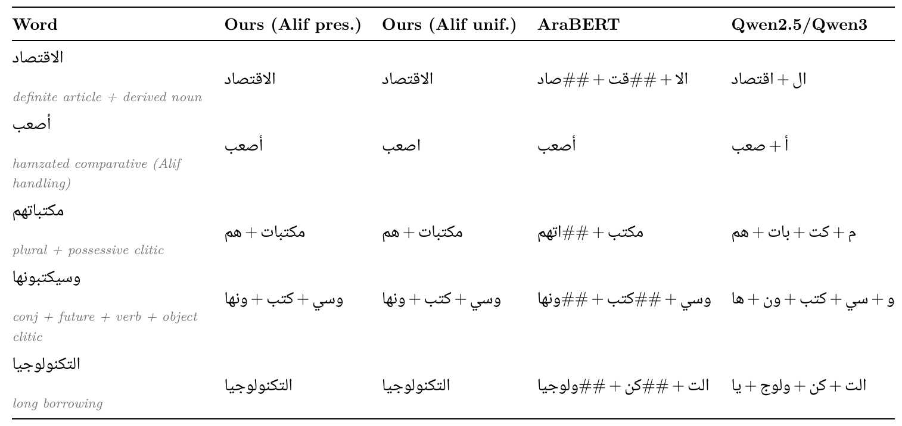
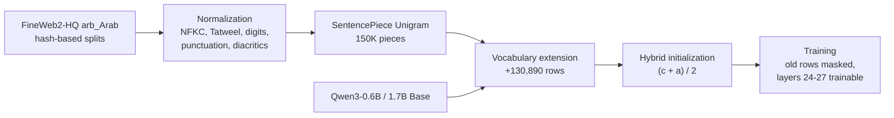

<div align="center">

# AraToken

**Optimizing Arabic Tokenization with Normalization Pipeline and Language Extension for Qwen3**

Mark Kashirskiy<sup>1,2</sup>, Artiom Lipinski<sup>3</sup>, Ilya Makarov<sup>4</sup>

<sup>1</sup>HSE University &nbsp; <sup>2</sup>ITMO University &nbsp; <sup>3</sup>Saint Petersburg State University &nbsp; <sup>4</sup>Trusted AI Center, RAS

[](https://arxiv.org/abs/2512.18399)
[](https://huggingface.co/mariklolik/AraToken-Qwen3-0.6B-LEP)
[](https://huggingface.co/datasets/mariklolik/AraToken-FineWeb2-HQ-ar)
[](LICENSE)

</div>

The Qwen3 tokenizer spends 2.2 tokens on an average Arabic word. AraToken spends 1.2. It is a
SentencePiece Unigram tokenizer trained on FineWeb2-HQ Arabic after an explicit orthographic
normalization step. The Language Extension Pipeline (LEP) puts its vocabulary into a pretrained Qwen3
model. The added embedding rows start from the average of two estimates, one built from the token's
Qwen3 sub-tokens and one from similar whole Qwen3 tokens. The original rows stay frozen, and training
touches only the new rows and the top four transformer layers.

This repository has the code, the tokenizers and the measurements of the paper. The tables in the
manuscript are generated from the JSON files in `results/`, and `scripts/paper/verify_numbers.py`
checks the 62 numbers quoted in the text against the same files.

<div align="center">

<br><sub>The same words under each tokenizer, each after its own normalization. Pieces are joined with "+".</sub>
</div>

## Results

Measured on the held-out `test` split. BPC is bits per character, which stays comparable when two
models cut the same text into different tokens.

| | AraToken / LEP | Baseline |
|---|---:|---|
| Tokens per word | **1.212** | 2.179 Qwen3, 1.833 AraBERT |
| Tokens per word, pruned to 60K pieces | **1.281** | 1.833 AraBERT (64K) |
| Arabic BPC, Qwen3-0.6B, 500M training tokens | **1.322** | 1.405 continued pretraining (CPT) |
| Arabic BPC, Qwen3-1.7B, 2,000 steps | **1.260** | 1.267 CPT |
| Characters per token in training and generation | **4.43** | 2.59 Qwen3 |
| Arabic BPC with the hybrid initializer, 2,000 steps | **1.347** | 1.358 WECHSEL-style, 1.358 FOCUS-style, 1.381 mean sub-token |
| OALL v2 native-Arabic macro accuracy | **0.405** | 0.392 base model, 0.379 CPT |

The BPC gaps between LEP and CPT hold under a paired bootstrap over test documents with
Holm-Bonferroni correction (p < 0.0001 for Qwen3-0.6B, p < 0.001 for Qwen3-1.7B). LEP pays for this on
English: after 500M tokens its WikiText-103 BPC is 1.138 against 1.068 for CPT.

## Models and data

| | |
|---|---|
| [mariklolik/AraToken-Qwen3-0.6B-LEP](https://huggingface.co/mariklolik/AraToken-Qwen3-0.6B-LEP) | Qwen3-0.6B-Base with AraToken, 500M tokens of adaptation |
| [mariklolik/AraToken-Qwen3-1.7B-LEP](https://huggingface.co/mariklolik/AraToken-Qwen3-1.7B-LEP) | Qwen3-1.7B-Base with AraToken and the hybrid initializer, 2,000 steps |
| [mariklolik/AraToken-Qwen3-0.6B-CPT](https://huggingface.co/mariklolik/AraToken-Qwen3-0.6B-CPT), [-1.7B-CPT](https://huggingface.co/mariklolik/AraToken-Qwen3-1.7B-CPT) | the matching baselines with the original tokenizer |
| [mariklolik/AraToken](https://huggingface.co/mariklolik/AraToken) | every tokenizer of the paper, including the extended Qwen3 tokenizers and the 80K algorithm grid |
| [mariklolik/AraToken-FineWeb2-HQ-ar](https://huggingface.co/datasets/mariklolik/AraToken-FineWeb2-HQ-ar) | the four document splits (4.1 GB) |
| [`tokenizers/`](tokenizers) | the AraToken SentencePiece models, also kept in this repository |

```python
from transformers import AutoModelForCausalLM, AutoTokenizer

repo = "mariklolik/AraToken-Qwen3-0.6B-LEP"
tokenizer = AutoTokenizer.from_pretrained(repo)
model = AutoModelForCausalLM.from_pretrained(repo, torch_dtype="bfloat16")

ids = tokenizer("تقع مدينة الإسكندرية على", return_tensors="pt").input_ids
print(tokenizer.decode(model.generate(ids, max_new_tokens=40)[0]))
```

The extended tokenizer normalizes its input itself. The bare SentencePiece models expect text that has
already gone through the same normalizer:

```python
import sentencepiece as spm
from aratoken.normalizer import paper_normalizer

sp = spm.SentencePieceProcessor(model_file="tokenizers/fw2hq_sp_alif_preserve/sentencepiece.model")
print(sp.encode(paper_normalizer().normalize_str("وسيكتبونها في مكتباتهم"), out_type=str))
```

## How it works



| Step | Code | What happens |
|---|---|---|
| Normalization | `aratoken/normalizer.py` | A `tokenizers` normalizer applies NFKC, drops Tatweel, maps Arabic-Indic digits and Arabic punctuation to Latin forms and strips diacritics. Alif unification exists but is off by default, because the hamza position carries grammatical information. |
| Tokenizer | `scripts/tokenizer/train.py`, `prune.py` | Unigram with 150,000 pieces on the `tok-train` split. Pruning keeps the most frequent pieces up to 99% or 95% corpus coverage (109,844 or 60,149 pieces). |
| Extension | `aratoken/vocab.py` | Adds every AraToken piece that starts with an Arabic letter and is missing from the Qwen3 vocabulary. |
| Initialization | `aratoken/init.py` | The compositional estimate c is the mean of the Qwen3 sub-token embeddings. The analogical estimate a is the overlap-weighted mean of the Qwen3 tokens that share the most character 2-4-grams. The new row is (c + a) / 2. Random, mean, moment-matched, WECHSEL-style and FOCUS-style initializers are there for the comparison. |
| Training | `aratoken/training.py` | A backward hook zeroes the gradient of the original embedding rows. Qwen3 ties input and output embeddings, so this also freezes their output rows. |

## Repository layout

```
aratoken/            normalizer, pre-tokenizer, split rule, vocabulary extension, initializers,
                     gradient masking, metrics, statistics
configs/             Hydra config of an adaptation run, tokenizer registries for the comparisons
scripts/data/        split builder, MinHash leakage check, pretokenization
scripts/tokenizer/   Unigram / BPE / WordPiece training, pruning, Qwen3 vocabulary extension
scripts/lep/         embedding initialization, run manifest, training entry point
scripts/eval/        fertility, BPC, significance tests, OALL, classification
scripts/paper/       LaTeX tables, figures, number check against the manuscript
slurm/               launchers for the run grid, the 500M-token runs and the tokenizer grid
tokenizers/          AraToken SentencePiece models
data/splits/         split manifest and the test and dev document ids
results/             measurements behind the tables and figures (JSON)
paper/               manuscript source, generated tables and figures
tests/               normalizer, split rule, gradient masking, tokenizer round trip
```

## Setup

```bash
git clone https://github.com/mariklolik/Aratoken.git && cd Aratoken
python -m venv .venv && source .venv/bin/activate
pip install -e ".[eval,paper,test]"
```

Installation takes about five minutes. We ran everything on Linux with CUDA 12, Python 3.11,
PyTorch 2.5.1 and Transformers 4.51.3, and `pyproject.toml` pins these versions. FlashAttention 2 is
used if it is installed. Commands below run from the repository root.

| Stage | Hardware | Time |
|---|---|---|
| Tables, figures and the number check | any CPU | under a minute |
| Tokenizer metrics | CPU, 16 GB RAM | 5-30 min per script |
| Training the 150K tokenizer | CPU, 256 GB RAM | about 3 h |
| One 2,000-step run, Qwen3-0.6B | 1 H100 80 GB | about 2 h |
| One 2,000-step run, Qwen3-1.7B | 1 H100 80 GB | about 3.5 h |
| One 500M-token run, Qwen3-0.6B | 4 H100 80 GB | 1.5-2.5 h |
| The whole run grid (56 runs) | H100 | about 115 GPU-hours |

## Quick check

The first four commands need neither a GPU nor a download. The last one needs the `test` split and
the extended tokenizers (see [Data](#data)). It recomputes Tables 3 and 5 in about five minutes on a
CPU, and the numbers match `results/intrinsic_metrics.json` exactly.

```bash
pytest -q tests
python -m scripts.paper.make_tables              # paper/tables/*.tex from results/
python -m scripts.paper.make_figures             # paper/figures/*.pdf from results/
python -m scripts.paper.verify_numbers           # 62/62 headline numbers match
python -m scripts.eval.intrinsic_metrics --out outputs/intrinsic_metrics.json
```

## Data

The corpus is the Arabic part of [FineWeb2-HQ](https://huggingface.co/datasets/epfml/FineWeb2-HQ)
(ODC-By 1.0). Each document goes to `lm-train`, `tok-train`, `dev` or `test` by a hash of its id, so
the splits cannot overlap. A MinHash check still finds a near-duplicate in the training splits for
0.65% of the test documents. [`data/README.md`](data/README.md) has the split sizes.

```bash
hf download mariklolik/AraToken-FineWeb2-HQ-ar --repo-type dataset --local-dir data/fineweb2hq-ar
hf download mariklolik/AraToken --include "extended/*" --local-dir tokenizers
```

`python -m scripts.data.build_splits` rebuilds the splits from FineWeb2-HQ. With
`--ids data/splits/test_ids.txt data/splits/dev_ids.txt` it restores the paper's `test` and `dev`
documents in their original order.

## Reproducing the paper

Each step writes the file in `results/` that ships with the repository, so a rerun can be compared
with the published one directly.

### Tokenizers

```bash
python -m scripts.tokenizer.train sp tokenizers/fw2hq_sp_alif_preserve --drop-diacritics --preserve-alif-forms
python -m scripts.tokenizer.train sp tokenizers/fw2hq_sp_alif_preserve_bf --drop-diacritics --preserve-alif-forms --byte-fallback
python -m scripts.tokenizer.train sp tokenizers/fw2hq_sp_alif_unified --drop-diacritics
python -m scripts.tokenizer.prune tokenizers/fw2hq_sp_alif_preserve --coverage 0.99 0.95
python -m scripts.tokenizer.prune tokenizers/fw2hq_sp_alif_unified --coverage 0.99 0.95
sbatch --array=1-12 slurm/tokenizer_grid.sbatch      # BPE, WordPiece, Unigram at 80K under 4 preprocessing settings
```

### Extended tokenizers, initial models and pretokenized data

```bash
T=tokenizers/extended/fw2hq-alif-preserve-150k
U=tokenizers/extended/fw2hq-alif-unified-150k
python -m scripts.tokenizer.extend_qwen --sentencepiece tokenizers/fw2hq_sp_alif_preserve/sentencepiece.model --out $T
python -m scripts.tokenizer.extend_qwen --sentencepiece tokenizers/fw2hq_sp_alif_unified/sentencepiece.model --out $U --unify-alif

for M in mean calib random wechsel focus hybrid; do
  python -m scripts.lep.init_embeddings --method $M --tokenizer $T --out models/qwen3-0.6b-fw2hq-alif-preserve-150k-$M
done
python -m scripts.lep.init_embeddings --method mean --tokenizer $U --out models/qwen3-0.6b-fw2hq-alif-unified-150k-mean
python -m scripts.lep.init_embeddings --method hybrid --tokenizer $T --base Qwen/Qwen3-1.7B-Base \
    --out models/qwen3-1.7b-fw2hq-alif-preserve-150k-hybrid

python -m scripts.data.pretokenize --tokenizer $T --out data/pretokenized/fw2hq-alif-preserve
python -m scripts.data.pretokenize --tokenizer $U --out data/pretokenized/fw2hq-alif-unified
python -m scripts.data.pretokenize --tokenizer Qwen/Qwen3-0.6B-Base --out data/pretokenized/fw2hq-qwen
```

The same `lm-train` text is 448M tokens with the extended tokenizer and 803M with the Qwen3 tokenizer
(`results/pretokenize_*.json`).

The paper's code added tokens and read the Qwen3 vocabulary in hash order, which changes from run to
run. This version sorts both by id. A rebuilt extended tokenizer therefore gets different ids for the
new tokens, and every initializer except `mean` gives slightly different rows. With the released
extended tokenizer from the Hub, `mean` reproduces the paper's initial model bit for bit, and training
from the paper's initial models reproduces their first-step `dev` loss (9.1449 hybrid, 9.4787 mean).
Use the Hub tokenizers with the released checkpoints.

### Training

`make_grid` writes one manifest row per 2,000-step run: the Alif by learning-rate
factorial, five trainable sets, five initializers, embeddings only, LoRA rank 16, CPT at equal compute
and at equal text, and the Qwen3-1.7B pair. Every run also logs the `dev` loss after the first step,
which is the first-step loss of Table 7.

```bash
python -m scripts.lep.make_grid                       # outputs/grid/manifest.tsv, 56 runs
sbatch --array=1-56 slurm/train.sbatch
sbatch slurm/train_500m.sbatch preserve               # LEP, 500M tokens
sbatch slurm/train_500m.sbatch cpt                    # CPT, 500M tokens
```

### Measurements

```bash
python -m scripts.eval.bpc_grid --min-step 2000                        # results/grid_bpc_with_init.json
python -m scripts.eval.bpc_grid --only '^scale17' --base-model Qwen/Qwen3-1.7B-Base --out results/grid_bpc_scale17.json
python -m scripts.eval.bpc_grid --grid-dir outputs/flagship --out results/grid_bpc_flagship_paired.json

Q=Qwen/Qwen3-0.6B-Base
LEP=outputs/flagship/preserve_s1/model/checkpoint-5086:$T
CPT=outputs/flagship/cpt_s1/model/checkpoint-5086:$Q
python -m scripts.eval.bpc --limit 1500 --out results/bpc_flagship.json \
    --model base=$Q --model flagship_preserve_500M=$LEP --model flagship_cpt_500M=$CPT
python -m scripts.eval.bpc --lang en --limit 1000 --out results/bpc_english_flagship.json \
    --model base=$Q --model flagship_preserve_500M=$LEP --model flagship_cpt_500M=$CPT

L=factorial_preserve_lr2e-4
python -m scripts.eval.stats_bpc --contrast $L:baseline_cpt_origtok --contrast $L:baseline_cpt_equaltext \
    --contrast init_hybrid:$L --contrast init_hybrid:init_wechsel --contrast init_hybrid:init_focus \
    --contrast init_hybrid:init_calib --contrast init_hybrid:init_random
python -m scripts.eval.stats_bpc --bpc results/grid_bpc_flagship_paired.json --contrast preserve:cpt \
    --out results/stats_flagship.json
python -m scripts.eval.stats_bpc --bpc results/grid_bpc_scale17.json --baseline __base_qwen3_1.7b \
    --contrast scale17hyb_lep:scale17full_cpt --out results/stats_scale17.json
python -m scripts.eval.start_loss
python -m scripts.eval.init_norm --tokenizer $T

python -m scripts.eval.intrinsic_metrics --report-morph
python -m scripts.eval.intrinsic_metrics --registry configs/registry_algorithms.json --limit 2000 \
    --out results/intrinsic_algorithms.json
python -m scripts.eval.intrinsic_metrics --registry configs/registry_bytefallback.json --limit 2000 \
    --out results/intrinsic_bytefallback.json
python -m scripts.eval.pruning_impact
python -m scripts.eval.dialectal_fertility

python -m scripts.eval.oall --model <checkpoint> --tokenizer <tokenizer> --tag lep             # also base, cpt
python -m scripts.eval.oall --lang en --model <checkpoint> --tokenizer <tokenizer> --tag lep
python -m scripts.eval.stats_oall
sbatch slurm/classification.sbatch <checkpoint> lep_flagship_500m                                # also base, CPT
python -m scripts.eval.collect_classification && python -m scripts.eval.stats_classification

python -m scripts.paper.make_tables && python -m scripts.paper.make_figures && python -m scripts.paper.verify_numbers
```

### Where each result comes from

| Paper | Script | Result file |
|---|---|---|
| Fig. 1, segmentation examples | `scripts/paper/segmentation_examples.py` | `paper/figures/segmentation_examples.pdf` |
| Fig. 5, norm shrinkage (Prop. 1) | `scripts/eval/init_norm.py` | `results/init_norm_shrinkage.json` |
| Table 3, Fig. 6, AraToken against other tokenizers | `scripts/eval/intrinsic_metrics.py` | `results/intrinsic_metrics.json` |
| Table 4, Figs. 7 and 12, algorithm by preprocessing | `scripts/eval/intrinsic_metrics.py --registry` | `results/intrinsic_algorithms.json` |
| Table 5, Fig. 8, pruning | `scripts/eval/intrinsic_metrics.py` | `results/intrinsic_metrics.json` |
| Table 6, Arabic BPC of LEP and CPT | `scripts/eval/bpc_grid.py`, `bpc.py` | `results/grid_bpc_with_init.json`, `bpc_flagship.json`, `grid_bpc_scale17.json` |
| Table 7, Fig. 10, initializers | `scripts/eval/bpc_grid.py`, `start_loss.py` | `results/grid_bpc_with_init.json`, `init_start_loss.json` |
| Table 8, text per token | `scripts/eval/bpc.py`, `scripts/data/pretokenize.py` | `results/bpc_flagship.json`, `pretokenize_*.json` |
| Table 9, OALL v2 | `scripts/eval/oall.py`, `stats_oall.py` | `results/oall/mcq/`, `stats_oall.json` |
| Table 10, Alif handling by learning rate | `scripts/eval/stats_bpc.py` | `results/stats.json` |
| Table 11, register and byte fallback | `scripts/eval/dialectal_fertility.py` | `results/dialectal_fertility.json`, `intrinsic_bytefallback.json` |
| Table 12, pruning cost by word frequency | `scripts/eval/pruning_impact.py` | `results/pruning_impact.json` |
| Table 13, Fig. 9, trainable set | `scripts/eval/bpc_grid.py`, `bpc.py --lang en` | `results/grid_bpc_with_init.json`, `bpc_english.json` |
| Table 14, classification and inference | `scripts/eval/classification.py` | `results/downstream_preds_mcq/`, `downstream.json`, `stats_downstream.json` |
| Table 15, English retention | `scripts/eval/bpc.py --lang en`, `oall.py --lang en` | `results/bpc_english_flagship.json`, `oall/mcq/en/` |
| Fig. 11, training curves | `scripts/paper/make_figures.py` | `results/curves/` |
| Significance tests | `scripts/eval/stats_bpc.py` | `results/stats.json`, `stats_flagship.json`, `stats_scale17.json` |
| Near-duplicate check (App. A) | `scripts/data/minhash_report.py` | `results/minhash_leakage.json` |
| Numbers quoted in the text | `scripts/paper/verify_numbers.py` | `paper/manuscript.tex` against `results/` |

## Citation

```bibtex
@article{kashirskiy2025aratoken,
  title   = {AraToken: Optimizing Arabic Tokenization with Normalization Pipeline and Language Extension for Qwen3},
  author  = {Kashirskiy, Mark and Lipinski, Artiom and Makarov, Ilya},
  journal = {arXiv preprint arXiv:2512.18399},
  year    = {2025}
}
```

The paper is under review at IEEE Access. We will add the journal reference here once it is published.

## License

Code, tokenizers and models are released under the [Apache License 2.0](LICENSE), the license of
Qwen3. The FineWeb2-HQ splits keep their ODC-By 1.0 license, and the evaluation datasets keep their
own licenses.

## Acknowledgments

This work was supported by a grant of the Ministry of Economic Development of the Russian Federation
(agreement No. 139-15-2025-011 of June 20, 2025, identifier 000000C313925P4G0002).

Questions go to Mark Kashirskiy, 353056@niuitmo.ru, or to the issue tracker.
